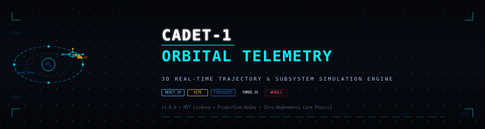
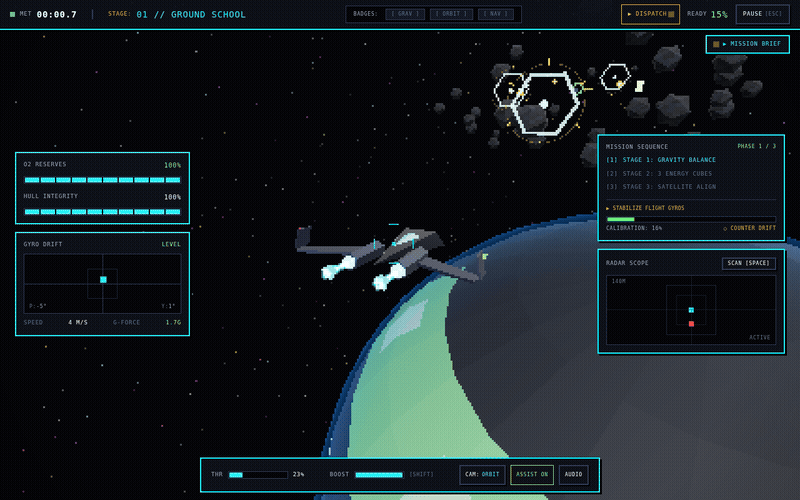
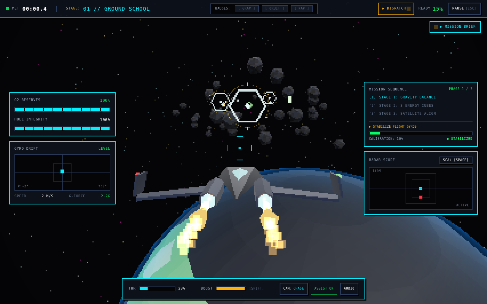
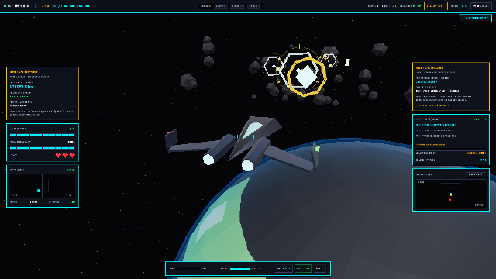

<p align="center">
  
</p>

<p align="center">
  <a href="https://github.com/NabilUbay5/cadet-1_-orbital-telemetry/actions/workflows/ci.yml"></a>
  <a href="https://react.dev"></a>
  <a href="https://vitejs.dev"></a>
  <a href="https://www.typescriptlang.org"></a>
  <a href="https://threejs.org"></a>
  <a href="https://webgl2fundamentals.org"></a>
  <a href="https://bun.sh"></a>
  <a href="https://opensource.org/licenses/MIT"></a>
  <a href="https://github.com/NabilUbay5/cadet-1_-orbital-telemetry/stargazers"></a>
</p>

---

## 🚀 Elevator Pitch

**CADET-1 Orbital Telemetry** is a browser-based flight simulation and astronaut training game built with **React 19**, **Vite 8**, **TypeScript 7**, and **Three.js r187**. It combines a WebGL 2.0 scene, arcade flight dynamics, live telemetry, three mission stages, and certification quizzes in an 8-bit CRT aesthetic.

It has two modes. **Flight Academy** is the three-stage flight simulation. **Outpost Ops** answers the Space Apps challenge directly: the player runs a Moon or Mars outpost for 30 days and balances power, oxygen, water, food and radiation shielding for a crew of four, with day and night at each site taken from NASA/JPL Horizons data.

Frame rate depends on the browser and renderer. Hardware rendering uses `requestAnimationFrame`; software rendering uses GPU synchronization and a timed fallback. The flight model is implemented in the project using Three.js math helpers, without a separate physics engine.

---

## 🛰 NASA Space Apps Challenge & Open Data Alignment

### Target challenge

| Item           | Detail                                                                                                     |
| -------------- | ---------------------------------------------------------------------------------------------------------- |
| **Event**      | [NASA Space Apps Challenge 2026](https://www.spaceappschallenge.org/2026/)                                 |
| **Local event**| Johor Bahru, Malaysia                                                                                      |
| **Team page**  | [Innovation of Skudai](https://www.spaceappschallenge.org/2026/find-a-team/innovation-of-skudai/)          |
| **Challenge**  | Build a Junior Astronaut Mission Trainer                                                                   |

> Space-themed STEM content often oversimplifies the engineering trade-offs that define a real mission or presents them at a level too complex to hold a young learner's attention. Few tools make those trade-offs both tangible and fun. Your challenge is to design and build an interactive game or app that lets students run a lunar or Martian outpost, balancing competing demands like life support, radiation shielding, power, and food production, so they experience firsthand the decisions that determine whether a mission fails or succeeds.

### NASA data and resources

To be eligible for a Global Award, a project must use NASA data or resources. Only list a source on the submission form if its status below is *Integrated*.

| Resource (form "Link Text") | Link | How the game uses it | Status |
| --- | --- | --- | --- |
| NASA/JPL Horizons System | [ssd.jpl.nasa.gov/horizons](https://ssd.jpl.nasa.gov/horizons/) | Provides the source service for the bundled outpost sunlight snapshot and the flight HUD Moon/Earth orbital reference replay. | **Integrated** |
| NASA/JPL Horizons API | [ssd.jpl.nasa.gov/api/horizons.api](https://ssd.jpl.nasa.gov/api/horizons.api) and [API documentation](https://ssd-api.jpl.nasa.gov/doc/horizons.html) | `scripts/fetch-horizons.ts` retrieves body summaries and site solar ephemerides; `scripts/fetch-flight-ephemeris.ts` retrieves Moon/Earth geometric state vectors. Saved queries, epochs, frames and units accompany the bundled data. | **Integrated** |
| NASA Open APIs portal | [api.nasa.gov](https://api.nasa.gov/) | No API endpoint or dataset from this portal is currently called by the project. Live space-weather data is a possible future integration. | **Planned only — not integrated** |

#### Implemented Horizons queries and provenance

- [scripts/fetch-horizons.ts](scripts/fetch-horizons.ts) calls the API with `bun run data:horizons` and generates [src/data/nasa/horizonsSnapshot.ts](src/data/nasa/horizonsSnapshot.ts). The committed snapshot keeps the game offline; the application does not make live Horizons requests.
- The body-summary queries use target `301` (Moon) and `499` (Mars), with `OBJ_DATA=YES` and `MAKE_EPHEM=NO`. The generator extracts solar-constant values in W/m² and mean solar-day values in seconds. These summary requests have no epoch, center, or reference frame.
- The site ephemeris queries use target `10` (Sun), `EPHEM_TYPE=OBSERVER`, `QUANTITIES=4`, and CSV output. Centers are `coord@301` for the Moon and `coord@499` for Mars. Sites are Mare Tranquillitatis (0.67° N, 23.47° E) and Jezero Crater (18.44° N, 77.45° E); the Mars query converts the site longitude to the west-positive convention required by Horizons.
- Query time type is UT, and `REF_SYSTEM=ICRF` is explicit; Horizons documents that setting for geometric/astrometric quantities. Quantity 4 returns topocentric, airless apparent azimuth/elevation of the target center in the local horizon frame (degrees); site longitude/latitude are degrees and elevation is kilometers. The lunar sunrise search starts 2027-01-01 UT and ends 2027-02-15 UT; its result determines the 30-day lunar snapshot window. The Mars ephemeris starts 2027-01-01 UT and runs for 30 sols plus an Earth-day buffer. Generated snapshot metadata records the actual epochs, centers, frame/output description, units, and full request URLs for reproducibility.
- At the recorded retrieval, Horizons body summaries reported mean solar constants of 1368 W/m² (Moon) and 589 W/m² (Mars), with mean solar days of 2,551,443.8 seconds and 88,775.24 seconds, respectively. These are service-reported body-summary values, distinct from gameplay tolerances.
- Daily sunlight is the fraction of samples with the Sun-center elevation above 0° multiplied by the body's mean solar constant relative to the Moon's. This is a sample-based, sun-tracking-panel game input, not a direct power measurement; dust and atmospheric effects are game events, not Horizons data. [outpostLogic.ts](src/game/outpostLogic.ts) reads the snapshot as plain numbers and has no network or DOM code; its tests run in `bun test`.

#### Flight-stage gameplay tolerances (not NASA data)

The pure rules in [src/game/missionLogic.ts](src/game/missionLogic.ts) use hand-tuned gameplay thresholds, not NASA vehicle limits, measurements, or Horizons mission constraints:

| Stage | Gameplay rule |
| --- | --- |
| 1 — piloting | Stay within ±4.5° pitch/yaw; build a 4-second hold, losing 0.5 seconds per second when out of tolerance; each ring adds 1 second. |
| 2 — retrieval | A cube is in range at less than 5 game-world units; collect 3 cubes. |
| 3 — docking | Lock below 45 game-world units and under 8° alignment error; hold for 3 seconds, losing 0.6 seconds per second when misaligned. |

Other game-design values include the 30 mSv scenario dose limit, 16% dose cut per shield layer, flare doses and timing, dust-storm timing and its 75% sunlight cut, and power, water, oxygen and food rates. None are represented as NASA mission standards. Dust and atmospheric effects are not modelled from NASA data.

#### Radiation values: reference-only and unverified

Outpost Ops currently uses static scenario inputs of 1.37 mSv per game day on the Moon and 0.64 mSv per sol on Mars. They are not Horizons data, API integrations, mission safety limits, or verified NASA calibration benchmarks. The referenced Chang'e-4 and Curiosity RAD primary full text could not be accessed to verify these exact numeric values during this work: the DOI publisher returned HTTP 403, PubMed required cookies, and NASA NTRS retrieval failed at the transport/DNS layer. Crossref metadata was accessible but did not establish the reported values. Treat both numbers as unverified scenario inputs, not authenticated measurements.

#### Flight HUD orbital reference and export

The amber panels in both flight HUD wings show a **bundled reference replay** of
the Moon relative to Earth's center, separate from the craft's simulated gauges.
The replay starts at **2027-01-16 07:00 TDB** and advances by flight mission elapsed
time (MET), including pause/reset behavior. It is not a live API feed or spacecraft
tracking data. The 145 geometric states cover 24 hours at 10-minute intervals in
the **ICRF equatorial frame**, with position in **km**, velocity in **km/s**, and
epochs in **Julian days TDB**. Cubic Hermite interpolation uses the positions and
velocities; the HUD displays unavailable readings beyond the source interval.

- Regenerate with `bun scripts/fetch-flight-ephemeris.ts`. The script saves the full
  query URL, retrieval time and API version in
  [flightEphemeris.ts](src/data/nasa/flightEphemeris.ts), plus the original NASA
  response in [horizons-flight-raw.json](data/nasa/horizons-flight-raw.json).
- **Export Flight Log** in pause, victory, or defeat downloads a JSON file through
  `FlightEngine.exportTelemetryLog()`. It records craft speed, attitude, stage,
  throttle, hull, oxygen, and energy once per simulation second, plus the latest
  reading on export. At most 3,600 samples are retained; the file reports how many
  older samples were dropped. Restart clears the prior flight. Each row includes
  the corresponding NASA reference reading; source/frame/units/query metadata is
  included once in the file.
- Canvas drawing-buffer dimensions remain `max(280, floor(width / 3))` by
  `max(180, floor(height / 3))` at pixel ratio 1, with pixelated CSS upscaling.
  HUD wings scroll independently on small or short screens, and modals remain
  scrollable so the export controls are reachable.

With the dev server running, the optional browser smoke checks cover widths
320, 390, 568, and 1280 px at device pixel ratio 2, reference epoch advancement,
all three modal downloads, and log reset. Terminal screens are tested using
controlled engine transitions, not a complete mission playthrough:

```bash
PLAYWRIGHT_MODULE=/path/to/playwright-core/index.mjs \
  CHROMIUM_PATH=/usr/bin/chromium node scripts/verify-hud.mjs
```

The telemetry-pod browser smoke test starts a mission, collects a pod using
thrust, verifies the HUD counter and radar marker update, then restarts and
checks that all pods return and a saved research balance survives a page reload.
It can run with Playwright and Chromium installed:

```bash
PLAYWRIGHT_MODULE=/path/to/playwright-core/index.mjs \
  CHROMIUM_PATH=/usr/bin/chromium node scripts/verify-telemetry-pods.mjs
```

Research Points (RP) are credited to the local research bank as missions progress:

- **Flight Academy:** 150 RP for Stage 1, 250 RP for Stage 2, and 400 RP for Stage 3 quiz completion, plus a 200 RP full-certification bonus. A full academy run earns 1,000 base RP, plus 100 RP per telemetry pod.
- **Outpost Ops:** completing 30 days earns 500 RP for the Moon (Standard site) or 800 RP for Mars (Hard site). Commander difficulty applies a 1.5× multiplier; Cadet earns the site base reward. Aborted missions earn no completion RP.

The balance is stored in browser local storage and shown in the lobby, flight
HUD, and debriefs. It is local to the current browser profile and is not synced
between devices. Use **EXPORT RESEARCH** in the lobby to download a versioned
JSON backup, or **IMPORT RESEARCH** to restore one. Import replaces the current
balance; invalid or unsupported files are rejected without changing saved
progress.

After the final certification, the victory screen keeps its pixel fireworks and
confetti running until any key or **EXIT LOBBY** returns to the title screen.
The heart bar reflects remaining player lives; reduced-motion settings disable
the animated effects.

### Other data, libraries and tools

For the submission form's "Space Agency Partner & Other Data" field. The software libraries are open source; the literature references below are separate, unverified scenario references.

| Name          | URL                               | Used for                          |
| ------------- | --------------------------------- | --------------------------------- |
| React         | https://react.dev                 | UI, HUD and modals                |
| Three.js      | https://threejs.org               | 3D scene, rendering, math helpers |
| Vite          | https://vite.dev                  | Dev server and production build   |
| TypeScript    | https://www.typescriptlang.org    | Strict type checking              |
| Tailwind CSS  | https://tailwindcss.com           | Styling                           |
| Bun           | https://bun.sh                    | Package manager and test runner   |
| Determination (font, CC BY 3.0) | https://fontstruct.com/fontstructions/show/2368299 | Custom UI and canvas typeface by anonymous-1438277, self-hosted with its original license and readme |
| Chang'e-4 lunar surface radiation (Zhang et al., 2020) | https://doi.org/10.1126/sciadv.aaz1334 | Reference for a literature-inspired Moon scenario input; the exact value is unverified here, as noted above. Not an API integration. |
| Curiosity RAD surface radiation (Hassler et al., 2014) | https://doi.org/10.1126/science.1244797 | Reference for a literature-inspired Mars scenario input; the exact value is unverified here, as noted above. Not an API integration. |

The checked-in banner, favicon, preview captures, SVG badges and procedural scene assets contain no NASA logo, seal, insignia or flag. NASA/JPL names remain as plain-text source attribution, not branding or endorsement. The previews are application captures; spacecraft and textures are generated in code.

### AI (SI) tool use

The following disclosure records the AI assistance documented in the repository. Check the event's current attribution and media rules before submitting.

- The unit tests added for `missionLogic.ts` and `fixedTimestep.ts`, and this section of the README, were drafted with an AI coding assistant (Claude Code) and reviewed by the team.
- OpenAI Codex assisted with the pooled procedural audio controller, visual effects, related tests, browser-capture automation, and their documentation. The preview GIF and screenshots are actual application captures.
- OpenAI Codex assisted with NASA orbital reference ingestion/interpolation, HUD layout, flight-log export, validation, and the associated documentation. Orbital states were retrieved from NASA/JPL Horizons; they were not generated by AI.
- The Outpost Ops mode was drafted with an AI coding assistant (Claude Code) and reviewed by the team: the game rules ([outpostLogic.ts](src/game/outpostLogic.ts)), its screen ([OutpostMode.tsx](src/components/OutpostMode.tsx)), its tests, the Horizons fetch script, and the related README text. The Horizons snapshot itself is NASA/JPL data, not AI-generated.
- GitHub Copilot assisted with the expanded certification question pool, NASA source links, question selection, and quiz interaction tests. Each displayed question links to its cited source.
- OpenAI Codex assisted with the final release audit, removal of unused dependencies/configuration, build chunking, offline browser verification, and submission documentation.
- Historical scaffolding: Git history records Google AI Studio/Gemini configuration and an unused design note, now removed from the current project. The original model/version and generation scope are not recorded; removing runtime integration does not erase development provenance.
- Completeness limit: repository evidence cannot identify unrecorded AI use. The team must confirm any additional tools or generated artwork before submitting this disclosure.

### Submission form readiness

| Form field                          | Required | Source                                       | Status                                         |
| ----------------------------------- | -------- | -------------------------------------------- | ---------------------------------------------- |
| Project Name                        | No       | Team decision                                | Placeholder on the form                        |
| Summary (50–200 words)              | Yes      | [Submission text](docs/submission.md)         | Draft ready; form entry unverified             |
| Project Demonstration               | Yes      | Video ≤ 30 s or ≤ 7 slides, public link       | GIF/PNG previews captured; final submission video/slides still needed          |
| Project link                        | Yes      | This public repository or a deployed build   | Ready to paste once the repo is final          |
| Project Details                     | Yes      | Architecture and Feature Matrix sections     | To write                                       |
| Use of SI                           | Yes      | AI (SI) tool use and [submission text](docs/submission.md) | Known use documented; team completeness check needed |
| NASA Data                           | Yes      | NASA data and resources, above               | Ready: list the rows marked *Integrated* only  |
| Space Agency Partner & Other Data   | No       | Other data, libraries and tools, above       | Ready                                          |
| Terms and originality checkboxes    | Yes      | Team                                         | Team to confirm                                |

Submissions close **Sunday, November 15, 2026 at 11:59 PM** in the local event's time zone.

---

## 🏗 Architecture Overview

The engine owns the simulation state and renders the Three.js scene. It sends telemetry and mission callbacks to React, which manages the HUD, quizzes, and modals. Keyboard events and HUD callbacks control the engine.

```text
+---------------------------------------------------------------+
| CADET-1 ARCHITECTURE                                          |
|                                                               |
| Keyboard / HUD controls                                       |
|            |                                                  |
|            v                                                  |
| +-------------------------+       +-------------------------+ |
| | FlightEngine            |------>| Three.js renderer       | |
| | Physics + mission state |       | Scene + camera + canvas | |
| +-------------------------+       +-------------------------+ |
|            |                                                  |
|            | telemetry callbacks                              |
|            v                                                  |
| +-------------------------+       +-------------------------+ |
| | React state (App)       |------>| HUD + quizzes + modals  | |
| | Updates >= 45 ms apart  |       | React + Tailwind CSS    | |
| +-------------------------+       +-------------------------+ |
+---------------------------------------------------------------+
```

### Key Architectural Decisions

| Decision                         | Implementation                                                                                                                                                                         |
| -------------------------------- | -------------------------------------------------------------------------------------------------------------------------------------------------------------------------------------- |
| **Zero-allocation hot path**     | Physics, collision, camera, and radar math reuse `private readonly` Vector3/Quaternion/Euler scratch fields; per-step input clearing uses `Set.clear()`. Only the telemetry snapshot sent to React is allocated, once per frame. |
| **Fixed-timestep accumulator**   | Frame delta is clamped to 0.05 s and consumed in `FIXED_DT = 1/60 s` steps ([fixedTimestep.ts](src/game/fixedTimestep.ts)), so damping, thrust, and stage timers match at any refresh rate. |
| **Pure mission rules**           | Stage thresholds live in allocation-free scalar functions ([missionLogic.ts](src/game/missionLogic.ts)) shared by the engine and the unit tests.                                      |
| **Strict TypeScript**            | `"strict": true` in `tsconfig.json`; no `any` or `@ts-ignore`.                                                                                                                         |
| **Software WebGL detection**     | Detects software renderers, disables shadows, and uses GPU fences plus timed scheduling.                                                                                               |
| **Low-resolution canvas**        | One-third viewport dimensions, with a 280 × 180 minimum, upscaled using pixelated CSS.                                                                                                 |
| **Throttled telemetry**          | The engine emits at most one telemetry snapshot per rendered frame; React accepts updates at least 45 ms apart (about 22 updates/s).                                                   |
| **Quiz-gated progression**       | Each stage requires a three-question quiz; all answers must be correct to advance.                                                                                                     |

---

## 🎮 Simulation Preview

These previews are captured from the running application in Chromium with software WebGL.
The GIF is a **9-second, silent, accelerated visual preview** of thrust/boost, scanner,
and camera modes; it is not a complete three-stage mission walkthrough.



| View | Preview |
| --- | --- |
| **Telemetry HUD / boost exhaust** |  |
| **Orbital camera / planetary limb** |  |

Additional cockpit, radar, and certification close-ups remain planned captures.
These repository assets support a project demonstration; they do not establish award
eligibility or replace checking the official submission format and public access.

### Capturing Assets

The capture script exercises the actual UI and writes the three assets above. Run
from the repository root, with the development server running in another terminal:

```bash
bun run dev

# Install capture-only tooling outside the checkout; app dependencies stay unchanged.
npm install --prefix /tmp/cadet-capture-tools --no-package-lock playwright-core@1.65.1
PLAYWRIGHT_MODULE=/tmp/cadet-capture-tools/node_modules/playwright-core/index.mjs \
  CHROMIUM_PATH=/usr/bin/chromium node scripts/capture-previews.mjs

# Browser audio and control checks (same tooling, running dev server)
PLAYWRIGHT_MODULE=/tmp/cadet-capture-tools/node_modules/playwright-core/index.mjs \
  CHROMIUM_PATH=/usr/bin/chromium node scripts/verify-audio.mjs
```

Capturing requires Node 24, Chromium with WebGL2 (SwiftShader is supported), and
FFmpeg on PATH. `APP_URL` optionally selects another running development server.
PNG screenshots are 1280 × 800; the GIF samples 72 real browser frames at 8 fps
and scales them to 800 × 500. Sampling/rendering time varies by machine, so GIF
playback is accelerated rather than a measurement of simulation frame rate.

### Audio and visual effects

[`audioEngine.ts`](src/game/audioEngine.ts) synthesizes all sound locally using the
Web Audio API; no audio files, service calls, keys, or new runtime dependencies are
needed. It unlocks on a user gesture, reuses a quantized noise buffer and a bounded
pool of 16 oscillator voices, and releases the graph on scene teardown. When all
voices are reserved, additional one-shot notes are dropped rather than allocating
new sources. Thruster level follows throttle; entering boost triggers ignition once.
Proximity pings accelerate near debris. Quiz answers and certification results have
distinct success/failure tones. **AUDIO / MUTE** in the HUD or **M** controls the
master gain, including notes already playing. Without Web Audio, gameplay continues
silently. The old `soundManager.ts` import remains a compatibility re-export.

The twin exhaust trails reuse a fixed buffer of 96 particles. Throttle increases
their length and opacity; boost changes them from cyan to amber and increases their
reach. Waypoints have pulsing guide halos; the planet has a procedural atmospheric
rim. These are stylized procedural visuals, **not NASA imagery or measured data**.

AI assistance was used to develop/refine the procedural audio controller, visual
FX, tests, capture automation, and this documentation. The preview assets are real
browser captures of the application, not generated illustrations.

---

## ⚙ Core Simulation Engine Example

The following is an **illustrative, condensed excerpt** of the flight and stage logic. It omits resource handling, audio, collision responses, and some state updates. See [flightEngine.ts](src/game/flightEngine.ts) for the complete implementation.

```typescript
// src/game/flightEngine.ts (excerpt: updateSimulation)
// 6-DOF Newtonian flight physics with stage-gated mission progression.
// Called once per FIXED_DT (1/60 s) step by the fixed-timestep accumulator.

private updateSimulation(dt: number) {
  // ── 1. ENVIRONMENTAL ROTATIONS ──────────────────────────────────────
  if (this.stationAlpha) {
    this.stationAlpha.rotatingRing.rotation.z += 0.08 * dt;
  }
  if (this.satelliteRelay) {
    this.satelliteRelay.group.rotation.y += 0.15 * dt;
  }

  // Tumble asteroid debris field
  for (const ast of this.asteroids) {
    ast.mesh.rotation.x += ast.rotationSpeed.x * dt;
    ast.mesh.rotation.y += ast.rotationSpeed.y * dt;
    ast.mesh.rotation.z += ast.rotationSpeed.z * dt;
  }

  // ── 2. INPUT → ANGULAR VELOCITY ─────────────────────────────────────
  const held = this.heldKeys;
  let yawInput = 0, pitchInput = 0, rollInput = 0;

  if (held['keya'] || held['arrowleft'])  yawInput += 1;
  if (held['keyd'] || held['arrowright']) yawInput -= 1;
  if (held['keyr']) pitchInput -= 1;
  if (held['keyf']) pitchInput += 1;
  if (held['keyq']) rollInput += 1;
  if (held['keye']) rollInput -= 1;

  const TURN_RATE = 1.4;
  this.angularVelocity.y += yawInput   * TURN_RATE * dt;
  this.angularVelocity.x += pitchInput * TURN_RATE * dt;
  this.angularVelocity.z += rollInput  * (TURN_RATE * 1.5) * dt;

  // Flight assist damping (damped harmonic oscillator approximation)
  const rotDamp = this.flightAssist ? 0.88 : 0.97;
  this.angularVelocity.multiplyScalar(Math.pow(rotDamp, dt * 60));

  // Quaternion integration (YXZ order = aerospace convention)
  this._deltaEuler.set(
    this.angularVelocity.x * dt,
    this.angularVelocity.y * dt,
    this.angularVelocity.z * dt,
    'YXZ'
  );
  this._deltaQuat.setFromEuler(this._deltaEuler);
  this.orientation.multiply(this._deltaQuat);
  this.craftGroup.quaternion.copy(this.orientation);

  // ── 3. THRUST → LINEAR ACCELERATION (reused scratch vector, no allocation) ──
  const speedMultiplier = this.isBoosting ? 65 : 38;  // m/s²
  this._forwardVec.set(0, 0, -1).applyQuaternion(this.orientation);
  this.velocity.addScaledVector(this._forwardVec, this.throttle * speedMultiplier * dt);

  // Linear drag when flight assist engaged
  if (this.flightAssist) {
    const linearDamp = 0.975;
    this.velocity.multiplyScalar(Math.pow(linearDamp, dt * 60));
  }

  // Position integration
  this.position.addScaledVector(this.velocity, dt);
  this.craftGroup.position.copy(this.position);

  // ── 4. STAGE-SPECIFIC TASK LOGIC ────────────────────────────────────
  // Extract Euler angles for stability assessment
  this._attitudeEuler.setFromQuaternion(this.orientation, 'YXZ');
  const pitchDeg = this._attitudeEuler.x * RAD_TO_DEG;
  const yawDeg   = this._attitudeEuler.y * RAD_TO_DEG;

  // STAGE 1: Ground School — Gyro Stabilization (±4.5° for 4s)
  if (this.stage === 1 && !this.stage1Complete) {
    // Gravitational turbulence perturbs attitude
    const turbPitch = Math.sin(this.metSeconds * 1.8) * 0.16;
    const turbYaw   = Math.cos(this.metSeconds * 1.4) * 0.16;
    this.angularVelocity.x += turbPitch * dt;
    this.angularVelocity.y += turbYaw   * dt;

    const isLevel = Math.abs(pitchDeg) <= 4.5 && Math.abs(yawDeg) <= 4.5;
    this.isCraftStabilized = isLevel;

    if (isLevel) {
      this.stabilizationTimer += dt;
      if (this.stabilizationTimer >= this.targetStabilizationTime) {
        this.stage1Complete = true;
        this.onStageTaskCompleted?.(1);  // → Triggers certification quiz
      }
    } else {
      this.stabilizationTimer = Math.max(0, this.stabilizationTimer - dt * 0.5);
    }

    // Waypoint rings give +1s calibration boost
    for (const ring of this.waypointRings) {
      if (!ring.passed && this.position.distanceTo(ring.group.position) < ring.radius) {
        ring.passed = true; ring.group.visible = false;
        this.vectorRingsPassedCount++;
        this.stabilizationTimer = Math.min(this.targetStabilizationTime, this.stabilizationTimer + 1.0);
      }
    }
  }

  // STAGE 2: Orbital Entry — Harvest 3 Energy Cubes
  if (this.stage === 2 && !this.stage2Complete) {
    for (const cube of this.energyCubes) {
      if (!cube.collected && this.position.distanceTo(cube.group.position) < 5.0) {
        cube.collected = true; cube.group.visible = false;
        this.energyCubesCollectedCount++;
        if (this.energyCubesCollectedCount >= 3) {
          this.stage2Complete = true;
          this.onStageTaskCompleted?.(2);
        }
      }
    }
  }

  // STAGE 3: Deep Space — Satellite Telemetry Alignment
  const satPos = this.satelliteRelay.group.position;
  const distToSat = this.position.distanceTo(satPos);

  // Heading error between craft forward and vector-to-satellite
  this._toTargetVec.subVectors(satPos, this.position).normalize();
  this._forwardVec.set(0, 0, -1).applyQuaternion(this.orientation);
  const alignDot = THREE.MathUtils.clamp(this._forwardVec.dot(this._toTargetVec), -1, 1);
  const alignErrorDeg = Math.acos(alignDot) * RAD_TO_DEG;

  if (this.stage === 3 && !this.stage3Complete) {
    if (distToSat < 45 && alignErrorDeg < 8.0) {
      this.satelliteLockTimer += dt;
      if (this.satelliteLockTimer >= 3.0) {
        this.stage3Complete = true;
        this.onStageTaskCompleted?.(3);
      }
    } else {
      this.satelliteLockTimer = Math.max(0, this.satelliteLockTimer - dt * 0.6);
    }
  }

  // ── 5. TELEMETRY ────────────────────────────────────────────────────
  // Readings are cached here and emitted once per rendered frame by flushTelemetry().
  this.telemetryPending = true;
}
```

### Telemetry Data Contract (`src/types/game.ts`)

Selected fields are shown below. The complete [TelemetryData interface](src/types/game.ts) also includes camera settings, resource totals, readiness, and audio state.

```typescript
export interface TelemetryData {
  // Core Flight State
  metSeconds: number;
  velocity: number;           // m/s
  acceleration: number;       // m/s²
  gForce: number;             // G
  pitch: number;              // degrees
  yaw: number;
  roll: number;
  driftAngle: number;         // angle between velocity & heading
  isInertialDrifting: boolean;

  // Life Support & Resources
  hullIntegrity: number;      // 0-100%
  oxygen: number;             // 0-100%
  energy: number;             // 0-100%
  boostCharge: number;        // 0-100%
  isBoosting: boolean;
  throttle: number;           // 0-100%

  // Mission Progression
  stage: MissionStage;        // 1 | 2 | 3
  stageTitle: string;         // "01 // GROUND SCHOOL"
  stageTaskTitle: string;     // "STABILIZE FLIGHT GYROS"
  stageTaskProgress: number;  // 0-100%
  stageTaskComplete: boolean;
  badgesUnlocked: string[];   // ["badge-gravity", "badge-orbital", "badge-deepspace"]

  // Stage-Specific
  stabilizationProgress: number;
  isStabilized: boolean;
  vectorRingsPassed: number;
  totalVectorRings: number;
  energyCubesCollected: number;
  totalEnergyCubes: number;
  satelliteDistance: number;
  satelliteAlignment: number; // degrees
  satelliteLockProgress: number;

  // Proximity Radar
  hazardWarning: boolean;
  hazardDistance: number;
  radarBlips: Array<{
    x: number; y: number;
    type: 'waypoint' | 'cube' | 'pod' | 'hazard' | 'satellite' | 'o2';
    distance: number;
  }>;
}
```

---

## 📊 Feature Matrix

| Module                   | Current implementation                                                                                | Source                                                                                |
| ------------------------ | ----------------------------------------------------------------------------------------------------- | ------------------------------------------------------------------------------------- |
| **3D renderer**          | Three.js r187, WebGL2, low-resolution canvas, ACES tone mapping, fog, and PMREM lighting.             | [Engine](src/game/flightEngine.ts)                                                    |
| **Telemetry HUD**        | React 19, Tailwind CSS 4, CRT overlay, pixel bars, and craft-relative radar.                          | [HUD](src/components/HUD.tsx), [App](src/App.tsx)                                     |
| **Flight physics**       | Thrust, quaternion rotation, fixed 1/60 s timestep, flight assist, and boost.                         | [Engine](src/game/flightEngine.ts)                                                    |
| **Stage progression**    | Gyro calibration, three energy cubes, satellite alignment, and three quiz gates.                      | [Engine](src/game/flightEngine.ts), [Quiz](src/components/CertificationQuizModal.tsx) |
| **Mission thresholds**   | ±4.5° pitch/yaw for 4 s; ring passes add 1 s; satellite distance <45 m and error <8° for 3 s.         | [Engine](src/game/flightEngine.ts)                                                    |
| **Badges**               | One badge per passed quiz, held in memory and reset on a new run.                                     | [App](src/App.tsx), [Badges](src/components/PixelBadge.tsx)                           |
| **Collision and damage** | 36 randomized asteroids, sphere-distance checks, reflected velocity, hull damage, shake, and hitstop. | [Engine](src/game/flightEngine.ts)                                                    |
| **Oxygen and energy**    | Oxygen drains 0.2 percentage points/s; canisters restore 35; energy recharges 8 points/s.             | [Engine](src/game/flightEngine.ts)                                                    |
| **Boost and scanner**    | Boost drains 26 charge points/s and recharges 14; scanner costs 15 energy and expands to 160 m.       | [Engine](src/game/flightEngine.ts)                                                    |
| **Camera system**        | Chase, cockpit, and offset orbit views; interpolated positions and boost-dependent field of view.     | [Engine](src/game/flightEngine.ts)                                                    |
| **Audio**                | Pooled procedural thrusters, boost, proximity pings, quiz chimes, and master mute.                    | [Audio engine](src/game/audioEngine.ts)                                            |
| **Procedural assets**    | Canvas textures with nearest filtering; low-poly craft, planet, stars, satellite, and debris.         | [Models](src/game/proceduralModels.ts)                                                |
| **React integration**    | Engine stored in a ref; telemetry and UI in state; effect cleanup calls engine disposal.              | [App](src/App.tsx)                                                                    |
| **Outpost Ops**          | Turn-based Moon/Mars base for a crew of four over 30 days: crew work blocks, seven buildable modules, power priority for life support, radiation dose and shielding, flares, dust storms, breakdowns, supply drones, and an end-of-mission debrief. An animated outpost scene shows buildings, night, dust storms and broken machines. A first-steps guide walks new players through day 1, and every shortage is logged with a plain-language "Why" that traces it to its cause. Sunlight per day comes from NASA/JPL Horizons. It is the main mission on the title screen (Enter); Flight Academy is the bonus mode (Space). | [Rules](src/game/outpostLogic.ts), [Screen](src/components/OutpostMode.tsx), [Data](src/data/nasa/horizonsSnapshot.ts) |

Outpost water is allocated once per day: stored water and powered ice mining
cover net crew needs first (after recycling), then oxygen generators, then
greenhouses. Water-dependent production scales down when supply is short; the
forecast and end-of-day results use the same allocation. Machines still draw
their assigned power while water-limited. These are game-scale rules.

Habitat shielding reduces the indoor share of both background and flare exposure;
outdoor work remains exposed. Sheltering stops outdoor jobs and cuts the remaining
indoor flare dose by 85%. The end-dose projection holds today's effective work
allocation constant and conservatively assumes future flares are unsheltered.

---

## 🌐 Play Online

Once GitHub Pages is switched on, every push to `main` publishes a playable build to **https://nabilubay5.github.io/cadet-1_-orbital-telemetry/** through [pages.yml](.github/workflows/pages.yml).

One-time setup by the repository owner: **Settings → Pages → Build and deployment → Source: GitHub Actions**, then re-run the "Deploy to GitHub Pages" workflow.

---

## 🛠 Getting Started — Step-by-Step

### 1. Prerequisites

| Requirement            | Supported setup                                                | Verification                                       |
| ---------------------- | -------------------------------------------------------------- | -------------------------------------------------- |
| **Node.js**            | Node 24 LTS, used in CI for Node-based tooling.                | `node --version`                                   |
| **Bun**                | Bun 1.4.4, pinned in CI.                                       | `bun --version`                                    |
| **Browser**            | WebGL 2.0; hardware acceleration recommended.                  | Browser GPU diagnostics, e.g. `chrome://gpu`.      |
| **Software rendering** | SwiftShader and llvmpipe are detected; performance is reduced. | Inspect the WebGL renderer in browser diagnostics. |

The engine disables shadows and uses a slower scheduling path when it detects software rendering. The low-resolution canvas is used on both hardware and software renderers.

### 2. Clone the Repository

```bash
# HTTPS
git clone https://github.com/NabilUbay5/cadet-1_-orbital-telemetry.git

# SSH (if you have keys configured)
git clone git@github.com:NabilUbay5/cadet-1_-orbital-telemetry.git

cd cadet-1_-orbital-telemetry
```

### 3. Optional Environment Configuration

The default workflow requires no `.env` file, API keys, or external services.

| Variable      | Required | Default             | Actual use                                                                             |
| ------------- | -------- | ------------------- | -------------------------------------------------------------------------------------- |
| `DISABLE_HMR` | No       | Unset (HMR enabled) | Setting the process variable to `true` disables Vite HMR; file watching stays enabled. |

To disable HMR, supply the variable to the process before Vite loads its config:

```bash
DISABLE_HMR=true bun run dev
```

### 4. Install Dependencies

```bash
bun install --frozen-lockfile
```

`bun.lock` is the single dependency lockfile. Use Bun for dependency changes (`bun add`, `bun remove`, or `bun install`) and commit the updated lockfile. CI uses `--frozen-lockfile` to reject unexpected dependency changes; do not generate npm, Yarn, or pnpm lockfiles.

### 5. Start the Development Server

```bash
bun run dev
```

The Vite dev server starts at **`http://localhost:3000`** (configurable in `package.json`).

```text
  VITE v8.x.x  ready in 320 ms

  ➜  Local:   http://localhost:3000/
  ➜  Network: http://192.168.x.x:3000/
```

Open the URL in a WebGL 2.0-capable browser. Click **PRESS START** or press **Enter** to begin. **Space** also starts the mission and triggers the scanner, spending 15 energy.

### 6. Production Build

```bash
# Type-check + unit tests + build
bun run lint
bun test
bun run build

# Preview production build locally
bun run preview
```

Output: `dist/` — static assets ready for any static host (Netlify, Vercel, Cloudflare Pages, GitHub Pages, Nginx, S3+CloudFront).

The production app has no external runtime API, SDK, font, or asset dependency and requires no API keys or `.env` file. Both modes, the bundled NASA replay, procedural audio and JSON export work without internet when `dist/` is served locally. Once loaded from a remote host, gameplay also continues disconnected. A first visit or reload of that remote host while offline is **not** supported by a service worker; retain a local build and static server for judging. NASA refresh scripts and optional source links require internet only when used. Development/install tooling still needs its dependencies.

The build runs strict TypeScript checks and splits React, the Three.js core and the renderer into static chunks; it does not suppress Vite warnings. No flight physics or mission thresholds change as part of release cleanup.

---

## 🎮 Controls Reference

| Action                   | Key or control                         | Behavior                                                                            |
| ------------------------ | -------------------------------------- | ----------------------------------------------------------------------------------- |
| **Start mission**        | `Enter` / `Space` / **PRESS START**    | Start from the title screen.                                                        |
| **Throttle up**          | `W` / `↑`                              | Increase throttle up to 100%.                                                       |
| **Throttle down**        | `S` / `↓`                              | Decrease throttle down to 0%.                                                       |
| **Yaw left / right**     | `A` / `←` and `D` / `→`                | Apply positive / negative yaw input.                                                |
| **Pitch − / +**          | `R` / `F`                              | Apply negative / positive pitch input.                                              |
| **Roll left / right**    | `Q` / `E`                              | Apply positive / negative roll input.                                               |
| **Afterburner**          | Hold `Shift`                           | Requires throttle >10% and charge >2%; thrust coefficient rises from 38 to 65 m/s². |
| **Cycle camera**         | `C`                                    | Chase → Cockpit → Orbit.                                                            |
| **Toggle flight assist** | `I`                                    | Toggle stronger rotational and linear damping.                                      |
| **Scanner pulse**        | `Space` during flight                  | Spend 15 energy on a visual pulse expanding to 160 m; radar updates separately.     |
| **Toggle audio**         | `M`                                    | Toggle the sound manager's mute state.                                              |
| **Pause / resume**       | `Esc` / `P`                            | Toggle flight between playing and paused.                                           |
| **Victory exit / defeat retry** | Any key / `R`                    | Victory returns to the title screen; `R` restarts after defeat.                    |
| **Toggle dispatch**      | Click **DISPATCH** / **MISSION BRIEF** | Show or hide the mission announcement; click **[X]** to dismiss it.                 |

---

## 📁 Project Structure

```text
cadet-1_-orbital-telemetry/
├── .github/workflows/ci.yml            # Install, type-check, test, and build with Bun
├── public/
│   ├── banner.png                      # README banner
│   ├── banner.svg                      # Editable banner source
│   └── assets/                         # Planned preview captures
├── src/
│   ├── App.tsx                         # Engine lifecycle and React state
│   ├── main.tsx                        # React entry point
│   ├── index.css                       # Tailwind and CRT styling
│   ├── types/game.ts                   # Telemetry and mission contracts
│   ├── game/
│   │   ├── audioEngine.ts              # Pooled procedural Web Audio controller
│   │   ├── exhaustParticles.ts         # Fixed-size twin exhaust trails
│   │   ├── flightEngine.ts             # Flight, missions, rendering, and input
│   │   ├── fixedTimestep.ts            # 1/60 s fixed-step accumulator
│   │   ├── missionLogic.ts             # Pure stage thresholds and timers
│   │   ├── outpostLogic.ts             # Outpost Ops rules: power, life support, radiation
│   │   ├── proceduralModels.ts         # Procedural textures and geometry
│   │   └── __tests__/                  # bun:test unit tests
│   ├── components/
│   │   ├── HUD.tsx                     # Flight telemetry and controls
│   │   ├── TitleScreen.tsx             # Mission lobby
│   │   ├── OutpostMode.tsx             # Outpost Ops screen (Moon/Mars base)
│   │   ├── Modals.tsx                  # Pause, victory, and defeat screens
│   │   ├── CertificationQuizModal.tsx  # Three questions per stage
│   │   ├── PixelBadge.tsx              # Stage badge graphics
│   │   ├── PixelConfetti.tsx           # Certification and victory confetti
│   │   └── PixelFireworks.tsx          # Continuous pooled victory fireworks
│   ├── audio/soundManager.ts           # Compatibility export for audioEngine
│   └── data/
│       ├── triviaBank.ts               # Nine questions total, three per stage
│       └── nasa/horizonsSnapshot.ts    # Generated NASA/JPL Horizons sunlight data
├── scripts/fetch-horizons.ts           # Regenerates the Horizons snapshot
├── index.html                          # HTML entry point and metadata
├── vite.config.ts                      # Vite, React, and Tailwind configuration
├── tsconfig.json                       # TypeScript configuration
├── package.json                        # Scripts and dependency declarations
├── bun.lock                            # Single dependency lockfile
├── LICENSE                             # MIT License
└── README.md                           # This file
```

---

### Custom typography

The app uses **Determination Regular** by **anonymous-1438277**, supplied from
[FontStruct](https://fontstruct.com/fontstructions/show/2368299). Its unmodified
package is stored in [`public/fonts/determination/`](public/fonts/determination/):

- `determination.ttf` — the supplied TrueType font.
- `license.txt` — the supplied CC BY 3.0 attribution notice.
- `readme.txt` — the supplied FontStruct redistribution notice.

Keep all three files together when distributing the font. Vite copies this folder
to `dist/fonts/determination/`; the CSS font URL is rewritten for the deployment
base, including GitHub Pages. There are no remote font requests.

[`src/index.css`](src/index.css) registers the regular face with `font-display: swap`
and maps Tailwind v4's sans, mono, and pixel families to it. Body text, telemetry,
HUDs, quizzes, modals, and arcade buttons use that family, with system monospace
fallbacks for unsupported glyphs. Bold UI text uses browser-synthesized weight
because only the regular face was supplied. The animated Outpost canvas uses the
same family and redraws as the local font becomes available. There is no Three.js
`TextGeometry` or `FontLoader` text pipeline to convert.

With a production preview running, verify actual rendered glyphs, canvas labels,
offline use, and byte-for-byte delivery of the font and both notices:

```bash
PLAYWRIGHT_MODULE=/path/to/playwright-core/index.mjs \
  CHROMIUM_PATH=/usr/bin/chromium node scripts/verify-fonts.mjs
```

Set `APP_URL` to test another preview or a GitHub Pages subpath, and optionally set
`FONT_SCREENSHOT_DIR` to save title, Outpost, and HUD captures.

## 🧪 Testing & Quality

```bash
# Strict type-check with the repository configuration (no emit)
bun run lint

# Unit tests (bun:test)
bun test

# Production build verification
bun run build
```

CI runs strict TypeScript checking, the `bun test` suite, the Vite production
build, and the telemetry-pod browser smoke test on every push to `main` and
every pull request.

The title screen scrolls independently on small and short viewports. With the dev
server running, check that real touch and wheel gestures can reach and activate
both mission buttons at 320×568, 390×844, 568×320, and 1280×800:

```bash
PLAYWRIGHT_MODULE=/path/to/playwright-core/index.mjs \
  CHROMIUM_PATH=/usr/bin/chromium node scripts/verify-title.mjs
```

This check uses coordinate taps/clicks after native scrolling, so automation cannot
hide an unreachable button by scrolling it into view automatically. `APP_URL` can
select a production preview; `TITLE_SCREENSHOT_DIR` optionally saves screenshots.

For the production offline smoke check, run `bun run preview --host 127.0.0.1 --port 4173 --strictPort`, then in another terminal:

```bash
PLAYWRIGHT_MODULE=/path/to/playwright-core/index.mjs \
  CHROMIUM_PATH=/usr/bin/chromium node scripts/verify-release.mjs
```

This launches a fresh browser context, blocks all external requests, loads the local production build, then disables networking entirely before checking NASA replay, the real flight-log download and Outpost Ops. The optional dev-server HUD check also accepts `HUD_OFFLINE=1` to check pause, victory and defeat exports while disconnected. See [the release audit](docs/release-audit.md) for results and limits.

| Check                  | What it covers                                                                                                                       |
| ---------------------- | ------------------------------------------------------------------------------------------------------------------------------------ |
| **Strict TypeScript**  | `"strict": true` across the app and tests, with no `any` or `@ts-ignore`.                                                            |
| **Stage thresholds**   | Stage 1 ±4.5° window, 4 s hold, half-rate decay, and +1 s ring bonus; Stage 2 5 m pickup radius and 3-cube goal; Stage 3 <45 m / <8° lock held for 3 s with 0.6× decay. Also pins every exported constant, strict vs. inclusive boundaries, timer clamping under 5,000 random steps, and `progressPercent` rounding, capping, and monotonicity. |
| **Fixed timestep**     | Same physics step count at 30, 60, 144, and 240 Hz; 0.05 s frame clamp prevents a spiral of death. Also covers remainder carry-over, zero and exact-clamp deltas, irregular frame jitter, per-instance state, and deterministic replay. |
| **Trivia bank**        | Three questions per stage, unique ids, four distinct options, in-range `correctIndex`, and one badge per stage.                       |
| **Outpost Ops**        | Horizons snapshot shape and the lunar night; solar output following the data; life support powered before jobs; shelter and shielding dose rules; build caps; stock limits; seeded replay; a balance check that a sensible scripted player completes most missions while a neglected Moon base usually fails; and the "Why" explanations for power, oxygen, water and food shortages. |

Tests live in [`src/game/__tests__/`](src/game/__tests__) and exercise the pure modules ([missionLogic.ts](src/game/missionLogic.ts), [fixedTimestep.ts](src/game/fixedTimestep.ts), [triviaBank.ts](src/data/triviaBank.ts)), so they run without WebGL or a browser. Audio graph lifecycle and exhaust buffer reuse are also covered by Bun tests. The optional browser checks render audio using OfflineAudioContext and exercise focused title controls, mute, the certification input lock, shuffled quiz answers, stage transitions, and pause/resume. The audio check steers the tilted craft using keyboard controls and HUD readings until it completes Stage 1's stabilization task. There is no automated visual-regression suite.

For a manual smoke check, start the app and verify the title screen, WebGL canvas, live telemetry, start/pause/resume controls, and return to lobby. The fixed timestep makes physics refresh-rate independent, but randomized asteroid placement means deterministic replay is not provided.

---

## 🚀 Deployment

### Static Hosting (Recommended)

| Platform             | Build and output                  | Configuration notes                                                                    |
| -------------------- | --------------------------------- | -------------------------------------------------------------------------------------- |
| **Netlify**          | `bun run build`; publish `dist/`. | Set Bun 1.4.4 and Node 24 in the site's build environment.                             |
| **Vercel**           | `bun run build`; output `dist/`.  | Select Vite and configure the Bun version used for installation.                       |
| **Cloudflare Pages** | `bun run build`; output `dist/`.  | Upload the static build or configure a compatible Bun build environment.               |
| **GitHub Pages**     | `bun run build`; deploy `dist/`.  | Set Vite `base` to `/cadet-1_-orbital-telemetry/`; add a separate deployment workflow. |
| **Nginx**            | `bun run build`; serve `dist/`.   | Configure the document root; use `try_files $uri $uri/ /index.html` for SPA fallback.  |
| **Apache**           | `bun run build`; serve `dist/`.   | Configure the document root; use `FallbackResource /index.html` for SPA fallback.      |

### Docker

This is an example recipe, not a committed Docker setup. It requires a `Dockerfile` and an `nginx.conf` that serves the built files. Ensure Node.js is available in the builder for the current tool scripts.

```dockerfile
# Dockerfile
FROM oven/bun:1.4.4 AS builder
WORKDIR /app
COPY package.json bun.lock ./
RUN bun install --frozen-lockfile
COPY . .
RUN bun run build

FROM nginx:alpine
COPY --from=builder /app/dist /usr/share/nginx/html
COPY nginx.conf /etc/nginx/conf.d/default.conf
EXPOSE 80
```

---

## 👥 Team contributors

Project maintainer: [@NabilUbay5](https://github.com/NabilUbay5)

- [@faustinamgo-rgb](https://github.com/faustinamgo-rgb)
- Fabian — [@lulzbot02](https://github.com/lulzbot02)
- [@nauracahya](https://github.com/nauracahya)
- [@tyo1616](https://github.com/tyo1616)

---

## 🤝 Contributing

### Visual Assets

1. Capture screenshots/GIFs per **Simulation Preview** table
2. Save them under the exact filenames in `public/assets/` listed above. These six filenames are allowed by `.gitignore`; other local captures remain ignored.
3. Replace the corresponding WIP status with an embed such as `` only after that file exists.
4. Include both the image and README update in the same PR so GitHub can render the preview.

### Code Contributions

```bash
# 1. Fork & clone
git clone https://github.com/YOUR-USERNAME/cadet-1_-orbital-telemetry.git

# 2. Create feature branch
git checkout -b feat/your-feature

# 3. Develop (type-check and tests pass)
bun run lint
bun test

# 4. Commit (conventional commits)
git commit -m "feat: add orbital decay simulation"

# 5. Push & PR
git push origin feat/your-feature
```

### GitHub contributor attribution

Use a commit email associated with your GitHub account, or your account-specific
GitHub `noreply` address, so GitHub can link your work to your profile. Submit your
changes through a pull request targeting `main` for the maintainer to review.
GitHub generates its Contributors list from qualifying commits on the default
branch; the team credits above are maintained separately.

### Development Guidelines

- **Zero new dependencies** without discussion (core is dependency-free physics)
- **Type safety** — strict mode is enabled; run `bun run lint` and `bun test`, and don't add `any` or `@ts-ignore`.
- **Pre-allocated math** in hot paths — no `new THREE.*()`, `.clone()`, or object literals per physics step; reuse the engine's `private readonly` scratch fields.
- **8-bit aesthetic** — nearest-neighbor, pixel-perfect, CRT scanlines
- **Accessibility goals** — improve keyboard navigation, reduced-motion support, and color contrast; these are not comprehensively validated.

---

## 📜 License

**MIT License** for project code — see [LICENSE](LICENSE) for full text.

The bundled **Determination** font is separately licensed under [CC BY 3.0](https://creativecommons.org/licenses/by/3.0/) by anonymous-1438277. Its original [license](public/fonts/determination/license.txt) and [redistribution notice](public/fonts/determination/readme.txt) accompany the unmodified font; the font is not relicensed under MIT.

```
Copyright (c) 2025 NabilUbay5

Permission is hereby granted, free of charge, to any person obtaining a copy
of this software and associated documentation files (the "Software"), to deal
in the Software without restriction, including without limitation the rights
to use, copy, modify, merge, publish, distribute, sublicense, and/or sell
copies of the Software, and to permit persons to whom the Software is
furnished to do so, subject to the following conditions:

The above copyright notice and this permission notice shall be included in all
copies or substantial portions of the Software.
```

---

## 🙏 Acknowledgments

- **Three.js** team — WebGL abstraction that doesn't get in the way
- **React** team — Concurrent features enabling smooth 60fps UI + physics
- **Vite** team — Instant HMR, optimized builds, first-class TS support
- **Tailwind CSS** — Utility-first styling for pixel-perfect 8-bit UI
- **Bun** — Fast installs, native TypeScript, Web APIs
- **Web Audio API** — For making chiptunes feel alive

---

<p align="center">
  <strong>CADET-1 ORBITAL TELEMETRY</strong><br/>
  <em>3D Real-Time Trajectory & Subsystem Simulation Engine</em><br/>
  <a href="https://github.com/NabilUbay5/cadet-1_-orbital-telemetry">GitHub</a> •
  <a href="https://github.com/NabilUbay5/cadet-1_-orbital-telemetry/issues">Issues</a> •
  <a href="https://github.com/NabilUbay5/cadet-1_-orbital-telemetry/discussions">Discussions</a>
</p>
